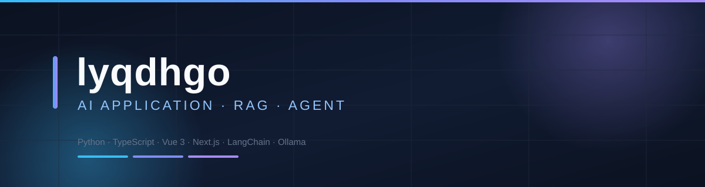

### AI 应用开发 · RAG 检索增强 · Agent 智能体

把大模型应用从原理做到能跑起来的产品。

---

## 🧭 关于我

我在系统性地把「大模型应用」从原理一路做到能跑的产品，关注三件事：

- **RAG 全链路** —— 文档解析 → 文本切分 → 向量化 → 检索召回 → 增强生成 → 引用溯源，以及检索质量到底怎么调。
- **Agent 工程** —— 不依赖框架手写 ReAct 循环、工具调用与多智能体编排，把「黑魔法」拆成能逐行讲清楚的代码。
- **能真正落地的项目** —— 每个仓库都保证「拿到手就能跑」：没有 API Key 也能演示、核心零第三方依赖可离线运行、关键路径有测试覆盖。

> 我的项目大多以「学习 + 面试可用」为目标：代码量精炼、分层清晰、中文注释完整，并且把设计取舍写进 README，而不只是给一份使用说明。

---

## 🚀 精选项目

<table>
<tr>
<td width="50%" valign="top">

### 🧩 [PocketAgent](https://github.com/lyqdhgo/PocketAgent)

自研 ReAct 工具调用循环 + **Planner → Workers → Reporter** 多智能体团队编排。

- 核心**零第三方依赖**（连 HTTP 都用 `urllib`）
- **无需 API Key** 即可完整演示
- 31 个单元测试 · 自带 Gradio 图形界面
- AST 白名单安全计算器（不用 `eval`）

`Python` · `Agent` · `ReAct`

</td>
<td width="50%" valign="top">

### 🎓 [Children_teach](https://github.com/lyqdhgo/Children_teach)

面向 **7 岁孩子**的启蒙学习 Agent，覆盖语文 / 数学 / 英语 / 学习习惯四大模块。

- 工作流图驱动状态机，**疲劳兜底边**强制休息
- 安全边界硬编码 + `--audit` 自动审计超纲题
- 自适应难度（三级 + 掌握度标记）
- 56 个测试（含 17 个架构约束测试）

`Python` · `状态机` · `零依赖`

</td>
</tr>
<tr>
<td width="50%" valign="top">

### 💬 [Chatbot](https://github.com/lyqdhgo/Chatbot)

开箱即用的**智能客服 Web 应用**，不需要数据库和云服务。

- 本地知识库 RAG + 余弦检索 Top-K
- 多轮上下文按「轮」裁剪
- **未命中自动转人工** + 未答问题收集
- SSE 流式输出 · 多厂商模型一键切换

`Next.js` · `TypeScript` · `RAG`

</td>
<td width="50%" valign="top">

### 🏢 [LangChain_RAG](https://github.com/lyqdhgo/LangChain_RAG)

**企业知识库问答系统**，完整的前后端 + 管理员后台。

- Flask + Vue 3 + MySQL + Chroma
- 本地模型：Ollama `qwen3:8b` + `qwen3-embedding:4b`
- 知识库隔离（一库一 collection）、幂等写入
- ECharts 数据看板 · JWT 鉴权 · 角色权限

`Python` · `Vue` · `Flask`

</td>
</tr>
<tr>
<td width="50%" valign="top">

### 🧪 [local_model_RAG](https://github.com/lyqdhgo/local_model_RAG)

LangChain / Ollama / OpenAI 的**学习脚本合集**，一文件一知识点。

- Prompt 模板 · Few-shot · 链式调用
- 消息类型 · 流式输出 · JSON 抽取
- Embedding · 余弦距离 · 本地模型接入

`Python` · `LangChain` · `学习笔记`

</td>
<td width="50%" valign="top">

### 📄 [arXiv-paper](https://github.com/lyqdhgo/arXiv-paper)

AI 方向的**论文阅读与笔记归档**，按主题整理 arXiv 论文要点与复现记录。

`Markdown` · `论文笔记`

</td>
</tr>
</table>

---

## 🛠 技术栈

| 分类 | 使用 |
| --- | --- |
| **语言** | Python · TypeScript · JavaScript |
| **大模型应用** | LangChain · LCEL · ReAct · Function Calling · RAG · Prompt Engineering |
| **模型服务** | Ollama（本地）· DeepSeek · OpenAI 兼容接口 · 通义千问 |
| **向量检索** | Chroma · Embedding · 余弦相似度 · 文本切分与召回调参 |
| **后端** | Flask · Flask-SQLAlchemy · Next.js Route Handlers · SSE 流式 |
| **前端** | Vue 3 · Vite · Pinia · Element Plus · ECharts · React · Tailwind CSS |
| **数据与工程** | MySQL · JWT · 单元测试 · 分层架构 · 原子写与并发控制 |

---

## 📊 GitHub 数据

---

### 📫 联系我

<!-- 想公开联系方式时，把下面这行的注释解开并改成你自己的：
**Email**：your@email.com · **掘金 / 知乎 / 博客**：https://your-blog.example.com
-->

欢迎在任意项目里提 **Issue** 交流，或者直接 **Star / Fork** ⭐

持续学习 · 持续输出 · 把原理做成能跑的代码

